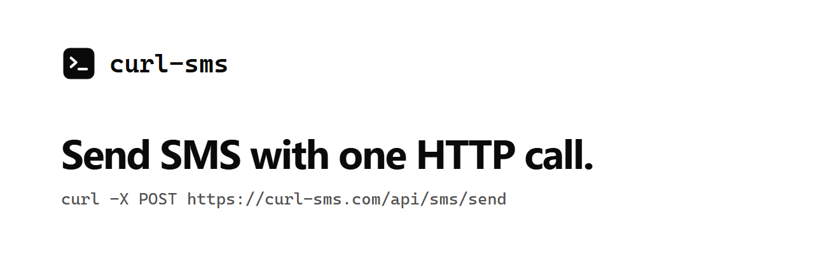

<picture>
  <source media="(prefers-color-scheme: dark)" srcset="https://raw.githubusercontent.com/curl-sms/.github/main/profile/assets/banner-dark.png">
  
</picture>

**curl-sms is an SMS API for developers.** Send a text message from scripts, servers, smart homes, CI pipelines and AI assistants with a single HTTPS request. Live in five minutes, 5 free SMS per month, no payment details needed.

[Website](https://curl-sms.com) · [Docs](https://curl-sms.com/docs) · [API reference](https://curl-sms.com/docs/api) · [Pricing](https://curl-sms.com/pricing) · [Integrations](https://curl-sms.com/integrations) · [Guides](https://curl-sms.com/sms-api)

```sh
curl -X POST https://curl-sms.com/api/sms/send \
  -H "Authorization: Bearer cs_test_…" \
  -H "Content-Type: application/json" \
  -d '{"receiver":"+4915123456789","body":"Hello from curl-sms"}'
```

Test keys (`cs_test_…`) run every check, send nothing and cost nothing. Swap in a live key when you are ready; your code stays the same.

### Use it from

| | |
|---|---|
| **[curl-sms](https://github.com/curl-sms/curl-sms)** | Copy-paste examples: curl, Python, Node.js, Go, PHP, Bash, PowerShell, plus recipes for Home Assistant, Uptime Kuma, n8n, cron and GitHub Actions |
| **[curl-sms-python](https://github.com/curl-sms/curl-sms-python)** | Official Python client · `pip install curl-sms` |
| **[curl-sms-node](https://github.com/curl-sms/curl-sms-node)** | Official Node.js / TypeScript client · `npm install curl-sms` |
| **[send-sms](https://github.com/curl-sms/send-sms)** | GitHub Action: SMS when a deploy fails or a release ships |
| **[curl-sms-mcp](https://github.com/curl-sms/curl-sms-mcp)** | Connect Claude, ChatGPT, Cursor and other AI assistants via MCP |

Also available as a [Synology app](https://curl-sms.com/docs/nas-app) and as a [self-hosted bridge for Docker](https://curl-sms.com/docs/bridge). Overview: [all integrations](https://curl-sms.com/integrations).

### Why curl-sms

- **One request.** `POST /api/sms/send` with a Bearer key and JSON. No SDK required.
- **Safe retries.** `Idempotency-Key` makes timeouts harmless; nothing is sent twice.
- **Delivery reports.** Status via `GET /api/sms/{id}` or signed webhooks (`queued` → `sent` → `delivered`).
- **Scheduling and bulk.** `send_at` up to a year ahead, up to 100 receivers per request.
- **No surprise bills.** Prepaid only: when included SMS and balance are used up, the API answers `402` instead of billing later.
- **Hosted in Germany.** Data stays on servers in Germany.

<sub>Questions: [help@curl-sms.com](mailto:help@curl-sms.com) · Security reports: see [SECURITY.md](https://github.com/curl-sms/.github/blob/main/SECURITY.md)</sub>
